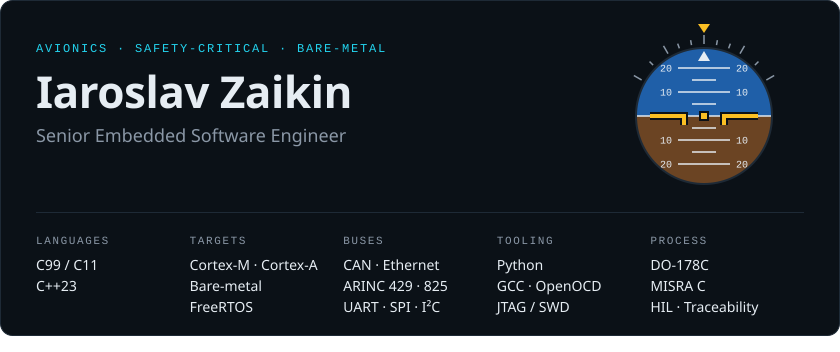
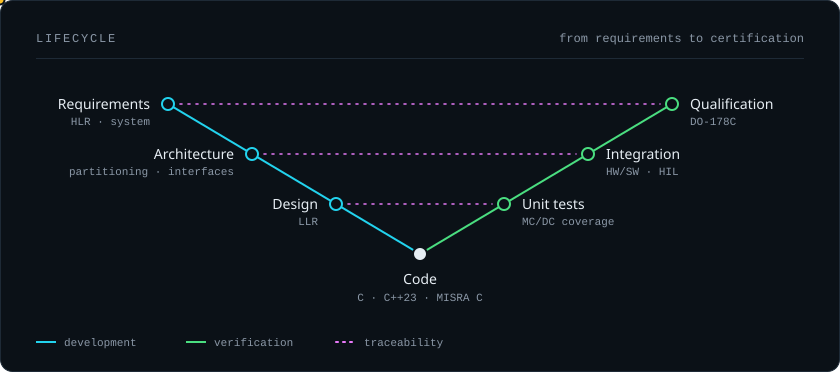
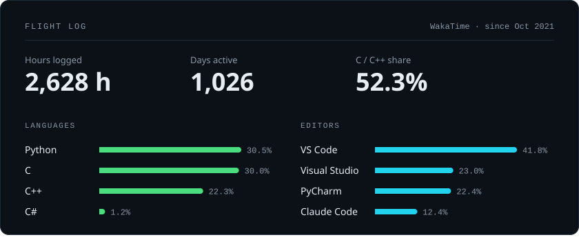

I write deterministic C and C++23 for avionics — bare-metal drivers, CAN and ARINC buses, network stacks on Cortex-M — and I run the lifecycle around the code: requirements, architecture, traceability, verification and DO-178C certification. Python is my test bench, not my product.

[LinkedIn](https://www.linkedin.com/in/iaroslav-zaikin/) · [Email](mailto:it@jaroslav-zaikin.ru) · [WakaTime](https://wakatime.com/@IaroslavDev)
